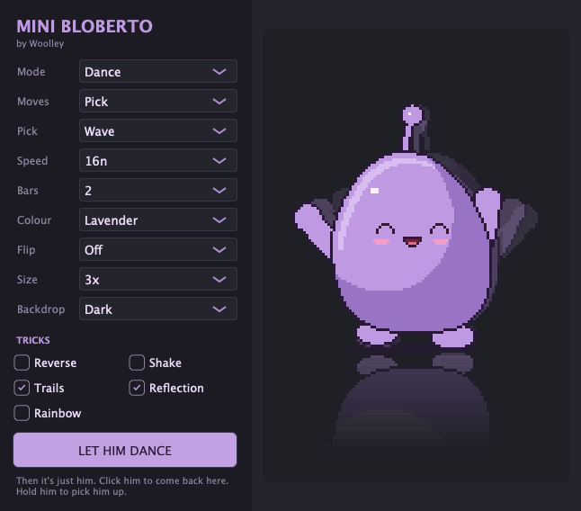
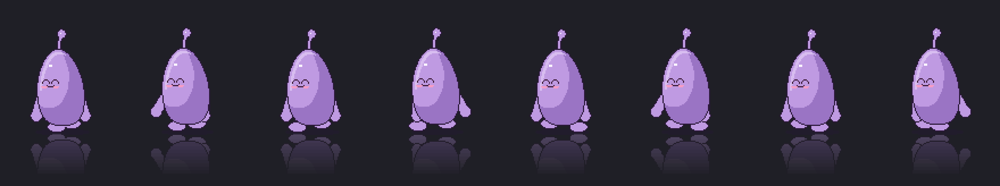

# Mini Bloberto: release text

Everything to paste into GitHub and socials for v1.0.0.

## (a) GitHub About

**Description:**

A little pixel blob who dances on the beat. Pass-through audio effect and stream overlay. AU, VST3 and Standalone, made with JUCE.

**Website:** leave empty, or your Woolley site.

**Topics:**

`audio-plugin` `vst3` `audio-unit` `juce` `pixel-art` `obs` `streaming` `music-visualizer` `beat-tracking` `daw` `cpp` `macos` `windows`

## (b) README

This is now the real `README.md` in the repo root. Copy below so it can be read in one place.
(Image paths here are relative to `docs/`; in `README.md` they start with `docs/images/`.)

---

# Mini Bloberto (README)

<p align="center"></p>

A little pixel blob who dances on the beat. Put him on a track in your DAW, or on a stream in
OBS, and he dances to the music. He doesn't touch the sound. Audio goes straight through,
bit for bit.

He comes as a Mac AU, a VST3 for Mac and Windows, and a Standalone app.

## What he does

He opens on a settings screen with a live preview. Pick how he dances, then press
**LET HIM DANCE**. The window shrinks to just him. Click him to get the settings back.
Hold the mouse on him and he dangles.

<p align="center"></p>

In a DAW he locks to the song's grid when you press play. With no clock (OBS, or the DAW
stopped) he listens for the beat in the audio and dances to that. In silence he does a
gentle idle bop.

He comes in four colours: Lavender, Bluebell, Periwinkle and Lilac.

<p align="center">


</p>

## Use him in a DAW

1. Install him (below) and open your DAW. Rescan plug-ins if it asks.
2. Put **Mini Bloberto** on any track as an audio effect. He is listed under Woolley.
3. Open his window, pick his moves, press LET HIM DANCE.
4. Press play.

He remembers his settings and his "just him" view with the project.

## Use him in OBS

He has a green, magenta or blue backdrop so OBS can key him out.

<p align="center"></p>

**With the Standalone app** (no OBS plug-in needed):

1. Open the Mini Bloberto app. Options > Audio settings: pick the input he should listen to
   (a mic, or a loopback device carrying your music). Untick "Mute audio input".
2. Set Backdrop to Green and pick a Size. Press LET HIM DANCE.
3. In OBS add a Window Capture of his window, then right-click it > Filters > + > Chroma Key,
   colour Green. Move and scale him anywhere on your scene.

**As a plug-in inside OBS:** OBS only loads old VST 2 plug-ins on its own. Install a VST3 host
filter such as atkAudio (OBS 31.1 or newer), then on your music or desktop audio source go to
Filters > + > atkAudio and add Mini Bloberto in it. Set the backdrop, press LET HIM DANCE,
then Window Capture plus Chroma Key as above.

## Controls

| Control | What it does |
|---|---|
| Mode | Still or Dance. |
| Moves | Pick (the move you choose), Random (a new move every few bars), Input (follows the loudness: still when quiet, bigger moves when loud), Cycle (every dance in turn). |
| Pick | Bop, Sway, Cheer, Kick, Jelly, Point, Spin, Wiggle, Jump, Held, Pump, Headbang, Robot, Twist, Flap, Shuffle, Wave, Moonwalk. |
| Speed | How fast the frames go: 8n, 16n or 32n. |
| Bars | How often Random, Input and Cycle change move: 1, 2, 4 or 8 bars. |
| Colour | Lavender, Bluebell, Periwinkle, Lilac. |
| Flip | Mirror him every bar or every 2 beats. |
| Size | 2x, 3x or 4x. He always stays sharp, whole pixels only. |
| Backdrop | Dark, or Green, Magenta or Blue for chroma key. |
| Tricks | Reverse, Shake (harder when it's loud), Trails, Reflection, Rainbow. |

Click him: settings come back. Hold him: he dangles.

<p align="center"></p>

## Install

**Mac** (macOS 11 or newer, Apple Silicon)

Download `MiniBloberto-1.0.0-mac.pkg` from the
[Releases page](https://github.com/woolleymusic/MiniBloberto/releases) and open it.
It puts the app in Applications and the AU and VST3 in `/Library/Audio/Plug-Ins`.

**Windows** (64-bit)

Download `MiniBloberto-1.0.0-win64.zip` from the Releases page and unzip it.

1. Close your DAW.
2. Copy the whole `Mini Bloberto.vst3` folder into `C:\Program Files\Common Files\VST3\`.
3. Put `Mini Bloberto.exe` anywhere you like. That's the Standalone app.

The Windows build isn't code-signed yet, so Windows may say "Windows protected your PC".
Click More info, then Run anyway.

## Build from source

You need CMake 3.22 or newer and JUCE 9.0.2.

**Mac** (Xcode command line tools, Ninja):

```sh
# JUCE, once: build and install it to ~/JUCE/install
git clone --branch 9.0.2 --depth 1 https://github.com/juce-framework/JUCE.git ~/JUCE
cmake -S ~/JUCE -B ~/JUCE/build -DCMAKE_INSTALL_PREFIX=$HOME/JUCE/install
cmake --build ~/JUCE/build --target install

# Mini Bloberto (README)
cmake -S . -B build -G Ninja -DCMAKE_BUILD_TYPE=Release
cmake --build build --target MiniBloberto_VST3 MiniBloberto_AU MiniBloberto_Standalone
tools/install.sh   # copies the AU and VST3 into ~/Library/Audio/Plug-Ins (quit the DAW first)
```

JUCE somewhere else? Add `-DJUCE_DIR=/path/to/install/lib/cmake/JUCE-9.0.2`.
For Intel Macs too, add `-DCMAKE_OSX_ARCHITECTURES="arm64;x86_64"`.

**Windows:** see [WINDOWS_BUILD.md](../WINDOWS_BUILD.md). It needs MSVC (Visual Studio 2022
Build Tools). JUCE 9 doesn't support MinGW.

**Signed Mac installer:** see [docs/SIGNING.md](SIGNING.md).

### Test without a DAW

`MiniBlobertoSnapshot` is a small command line tool that runs the plug-in with no host:

```sh
cmake --build build --target MiniBlobertoSnapshot
S=build/MiniBlobertoSnapshot_artefacts/Release/MiniBlobertoSnapshot
$S --selftest                                      # pass-through check: output must equal input
$S --png out.png --ppq 1.25 --set pick=16          # the window at any beat, any settings
$S --dancer --png him.png --set backdrop=1         # just him
$S --strip strip.png --set moves=0 --set pick=17   # one frame per 16th across 2 beats
$S --wav song.wav --seconds 24                     # no clock, like OBS: prints the tempo he hears
```

`--set` takes a parameter id and a choice number: `mode moves pick speed bars colour flip
size backdrop`, and 0 or 1 for `reverse shake trails reflect rainbow`. The pictures in
`docs/images` were all made this way.

## How he's made

The sprites are in `resources/Bloberto_<Colour>.png`: 8 frames by 18 rows of 110 by 128
pixels, one sheet per colour, scaled up by whole numbers so he stays crisp.
The beat tracker runs on the audio thread without allocating. The audio is never changed.

He started as a Max for Live device and was ported to JUCE so he works everywhere.

Made by Woolley.

---

## (c) GitHub Release notes: v1.0.0

**Title:** Mini Bloberto 1.0.0

**Body:**

Mini Bloberto is a little pixel blob who dances on the beat. Put him on a track or on your
stream and he dances to the music. Your audio goes straight through, untouched.


**What's in 1.0.0**

- 18 dances: Bop, Sway, Cheer, Kick, Jelly, Point, Spin, Wiggle, Jump, Held, Pump, Headbang,
  Robot, Twist, Flap, Shuffle, Wave and Moonwalk.
- Pick one move, or let him choose: Random, Cycle, or Input (bigger moves when it's loud).
- Locks to your DAW's grid when you press play.
- No clock? He listens for the beat in the audio and dances to that. Handy in OBS.
- Four colours: Lavender, Bluebell, Periwinkle, Lilac.
- Green, magenta or blue backdrop for chroma key.
- Tricks: Reverse, Shake, Trails, Reflection, Rainbow. Flip and Size (2x, 3x, 4x).
- Settings screen, then LET HIM DANCE and the window is just him. Click him to change things.
  Hold him and he dangles.
- Remembers everything with your project.

**Downloads**

- `MiniBloberto-1.0.0-mac.pkg`: Mac installer (macOS 11 or newer, Apple Silicon). Installs
  the AU, the VST3 and the app. Signed and notarized.
- `MiniBloberto-1.0.0-win64.zip`: Windows 64-bit. VST3 and the app. Copy
  `Mini Bloberto.vst3` into `C:\Program Files\Common Files\VST3\`. Not code-signed yet, so
  click More info, then Run anyway, the first time.

**Using him in OBS**

The easiest way: open the Standalone app, point its input at your music, set Backdrop to
Green, press LET HIM DANCE, then Window Capture plus a Chroma Key filter in OBS. The README has
the steps, and the plug-in route too.

Found a bug? Open an issue. Tell me your DAW, your OS, and what he did.

## (d) Short blurbs

**The App (Standalone)**

Mini Bloberto is a little pixel blob who dances to whatever you're playing. Open the app,
pick a mic or your music, and he finds the beat on his own. Give him a green backdrop and
drop him on your stream in OBS. 18 dances, four colours, free for Mac and Windows.

**The Plugin (AU / VST3)**

Mini Bloberto is a dancing pixel blob for your DAW. Put him on any track and he dances in
time with your song. He doesn't change the sound at all. Pick a move or let him choose, add
trails, a reflection or a rainbow, and shrink the window to just him. Good company while you
make beats, and fun on screen recordings. AU and VST3, free.
